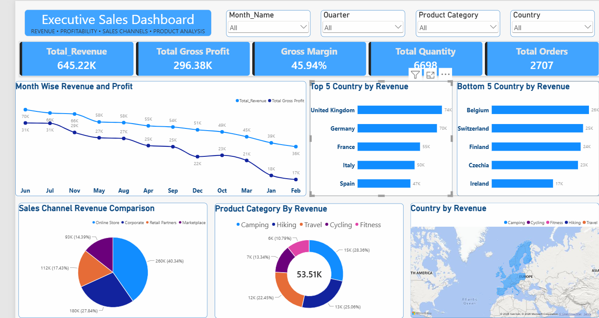

# Executive Sales Dashboard – Power BI

## Project Overview
An interactive sales dashboard developed using Microsoft Power BI to analyze revenue, profitability, sales channels, product categories, and country-wise performance.

## Tools Used
- Microsoft Power BI
- Power Query
- DAX
- Data Visualization

## Key Performance Indicators
- Total Revenue: 645.22K
- Total Gross Profit: 296.38K
- Gross Margin: 45.94%
- Total Quantity: 6,698
- Total Orders: 2,707

## Dashboard Preview

## Project Files
- `Executive-Sales-Dashboard.pbix` – Power BI dashboard file.
- `Sales-Raw-Data.xlsx` – Raw sales dataset.
- `Dashboard.png` – Dashboard screenshot.
- ## Dashboard Preview

